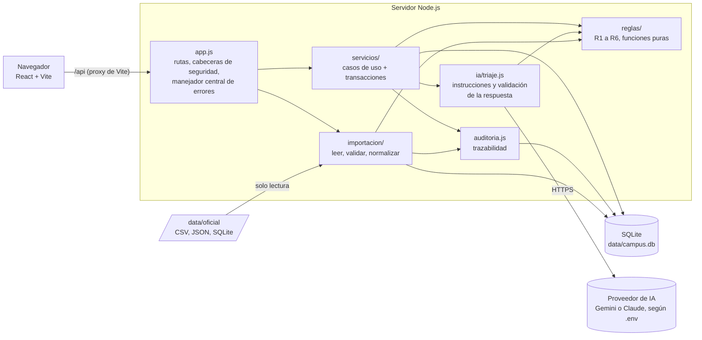
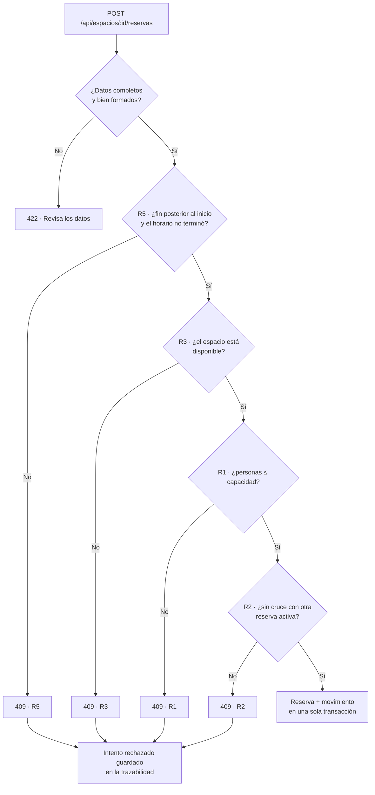
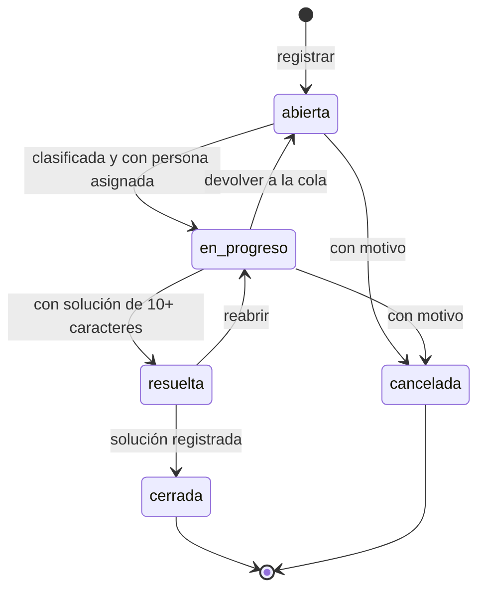
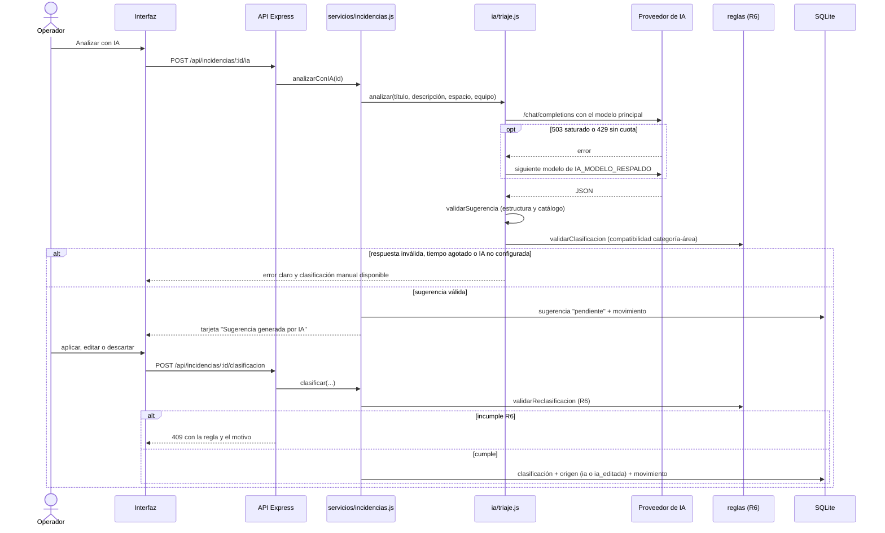
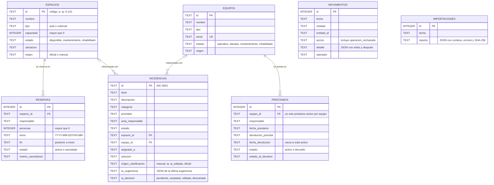

# Sistema Central de Gestión Operativa del Campus

MVP para la hackatón de Campuslands **"El campus bajo presión"**. Centraliza en
una sola aplicación web:

1. **Gestión de espacios**: aulas y cubículos, capacidad, estado, disponibilidad en vivo, reservas y un asistente de asignación.
2. **Recursos tecnológicos**: inventario, estado operativo, préstamos, devoluciones e historial de cada equipo.
3. **Incidencias y solicitudes con IA**: registro, triaje inteligente (categoría, prioridad, área y ruta de atención), revisión humana y ciclo de vida hasta el cierre.

Las seis reglas de negocio obligatorias se validan **en el backend**, en un solo
lugar (`server/src/reglas/`), y aplican igual a una persona, al importador de
datos oficiales y a las sugerencias de la IA.

---

## Arranque rápido

Requisitos: **Node.js 22.13 o superior** (usa el módulo nativo `node:sqlite`, sin compilar nada).

```bash
npm run instalar
```

```bash
cp .env.example .env
```

```bash
npm run dev
```

- Interfaz: http://localhost:5173 (Vite, con recarga en caliente).
- API: http://127.0.0.1:3000/api (Express, se reinicia sola al guardar).

Otros comandos:

| Comando | Qué hace |
|---|---|
| `npm test` | Pruebas automáticas de las 6 reglas, los flujos, la IA y el importador |
| `npm start` | Compila la interfaz y la sirve desde el mismo servidor en el puerto 3000 |
| `npm run probar-ia` | Hace una consulta real de triaje con la IA del `.env` y muestra la respuesta validada o el error exacto |
| `npm run importar` | Vista previa del análisis de los datos oficiales (no escribe nada) |
| `npm run importar -- --aplicar` | Importa los registros válidos |

---

## Arquitectura

```
hackaton-campuslands/
├── server/                      API Node.js + Express 5
│   ├── src/
│   │   ├── reglas/              Lógica de negocio determinista (funciones puras)
│   │   │   ├── catalogos.js         estados, categorías, áreas, transiciones, sinónimos
│   │   │   ├── errores.js           ReglaNegocioError (409), ValidacionError (422)
│   │   │   ├── reglasEspacios.js    R1 aforo, R2 cruces, R3 estado, R5 reservas
│   │   │   ├── reglasEquipos.js     R4 disponibilidad, R5 préstamos/devoluciones
│   │   │   └── reglasIncidencias.js R6 máquina de estados y compatibilidad
│   │   ├── servicios/           Casos de uso: consultan, aplican reglas, guardan + trazan en una transacción
│   │   ├── db/conexion.js       Persistencia SQLite (esquema, restricciones, transacciones)
│   │   ├── importacion/         Lectura, validación y normalización de los datos oficiales
│   │   ├── ia/                  Integración de IA (configuración, proveedores, triaje y validación)
│   │   ├── app.js               Rutas HTTP, cabeceras de seguridad, manejador central de errores
│   │   └── index.js             Arranque
│   └── test/                    node:test (sin dependencias)
├── client/                      React 19 + Vite
│   └── src/
│       ├── api.js               Cliente HTTP y traducción de errores
│       ├── componentes/         Modal, confirmación, notificaciones, insignias, límites de error
│       └── paginas/             Panel, Espacios, Equipos, Incidencias, Datos oficiales, Trazabilidad
├── data/
│   ├── oficial/                 Archivos entregados por Campuslands (solo lectura)
│   └── campus.db                Base operativa (se crea sola, no se versiona)
└── .env.example                 Variables de entorno sin secretos
```



Las reglas no dependen de Express ni de la base: reciben datos y aprueban o
rechazan. Por eso las usan por igual los servicios, el importador y la
verificación de las sugerencias de IA.

**Por qué este stack:** es el sugerido (React + Vite, Node + Express, SQLite),
ya estaba instalado y no requiere servicios externos. SQLite se usa con el
módulo nativo `node:sqlite` para evitar dependencias que haya que compilar. La
interfaz habla con la API a través del proxy de Vite (mismo origen, sin CORS).
Dependencias de producción: `express` y `@anthropic-ai/sdk` en el servidor;
`react` y `react-dom` en el cliente.

**Flujo de una operación** (por ejemplo, reservar):
`interfaz → POST /api/espacios/:id/reservas → servicios/espacios.js → reglas/reglasEspacios.js → SQLite (reserva + movimiento en la misma transacción)`.
Si una regla falla, la API responde `409` con el código de la regla
(`R1_AFORO`, `R2_CRUCE_HORARIO`, ...), la interfaz muestra el motivo y el
intento rechazado queda en la trazabilidad.

---

## Reglas de negocio y casos de demostración

Todas viven en `server/src/reglas/` y se prueban en `server/test/reglas.test.js`
(funciones puras) y `server/test/flujos.test.js` (servicios + base real).

| Regla | Caso válido | Caso inválido (rechazado) |
|---|---|---|
| **R1 · Aforo** | 30 personas en un aula de 30 | 31 personas en un aula de 30; reducir la capacidad por debajo de una reserva futura |
| **R2 · Conflictos de horario** | Reserva 10:00–12:00 después de otra 08:00–10:00 (intervalos semiabiertos) | Reserva 09:00–11:00 sobre otra 08:00–10:00; reserva contenida dentro de otra |
| **R3 · Estado del espacio** | Reservar un espacio *disponible* | Reservar un espacio en *mantenimiento* o *inhabilitado* |
| **R4 · Disponibilidad de equipos** | Prestar un equipo *operativo* sin préstamo activo | Prestar un equipo *dañado*, *inhabilitado* o ya prestado (además hay un índice único en la base) |
| **R5 · Integridad de operaciones** | Préstamo con devolución prevista futura; devolución de un préstamo activo | Fin antes del inicio; reservar un horario pasado; doble devolución; cancelar dos veces; pasar a mantenimiento un espacio con reservas futuras; cambiar el estado de un equipo prestado sin registrar la devolución; serial o código duplicado |
| **R6 · Integridad de incidencias** | abierta → en progreso con clasificación y responsable; resuelta → cerrada con solución | Cerrar una incidencia abierta (salta estados); resolver sin solución; cancelar sin motivo; modificar una cerrada; asignar "Red" a "Servicios generales"; reasignar una en progreso a otra área sin indicar quién la atiende |

Orden de validación de una reserva (`validarNuevaReserva` en `reglasEspacios.js`):



Máquina de estados de incidencias (`TRANSICIONES_INCIDENCIA` en `catalogos.js`):



| Desde | Puede pasar a | Lo que exige |
|---|---|---|
| abierta | en progreso, cancelada | En progreso: categoría, prioridad, área y persona asignada. Cancelada: motivo |
| en progreso | resuelta, abierta, cancelada | Resuelta: solución de 10 caracteres o más |
| resuelta | cerrada, en progreso (reabrir) | Cerrada: solución registrada |
| cerrada, cancelada | ninguno | Son históricas: no se editan ni se reasignan |

### Guion para la sustentación

1. **Espacios → Nuevo espacio**: crear `CUB-01` con capacidad 4. Reservar para 6 personas: **R1**.
2. Reservar un aula 08:00–10:00 y luego otra 09:00–11:00: **R2**. Ver el motivo en el formulario y en **Trazabilidad** (filtro "Solo rechazadas por reglas").
3. Editar el aula a *mantenimiento*: **R5** (tiene reservas futuras). Cancelar la reserva y repetir: se permite. Intentar reservarla: **R3**.
4. **Asistente de asignación**: pedir 5 personas en un horario; muestra compatibles y descartados con la regla de cada uno.
5. **Recursos tecnológicos**: prestar un portátil, intentar prestarlo de nuevo (**R4**), devolverlo como *dañado* y volver a prestarlo (**R4**).
6. **Incidencias → Nueva**: "Sugerir con IA". Revisar la tarjeta marcada como generada por IA, copiar al formulario, editar si hace falta y registrar. En el detalle: aplicar, editar o descartar; elegir un área incompatible: **R6**. Llevarla a en progreso, resuelta y cerrada.
7. Sin IA configurada (o con una clave inválida): el botón de IA muestra el error y la clasificación manual sigue disponible.

---

## Integración de Inteligencia Artificial

**Funcionalidad:** triaje de incidencias. A partir del título y la descripción
(y del espacio o equipo relacionado), el modelo propone categoría, prioridad,
área responsable, justificación, ruta de atención paso a paso, si requiere
atención inmediata y un nivel de confianza.



La IA nunca escribe la clasificación: la sugerencia queda "pendiente" hasta
que una persona decide, y lo que se aplica pasa por la misma regla R6 que una
clasificación manual.

**Proveedor:** se define solo con variables de entorno (`.env`). No hay
credenciales ni endpoints escondidos en el código; si no se configura, la IA
queda desactivada y la aplicación lo dice.

| `IA_PROVEEDOR` | Uso | Variables |
|---|---|---|
| `anthropic` | API de Claude con el SDK oficial `@anthropic-ai/sdk` y salidas estructuradas (JSON Schema). Con modelos que lo admiten activa el respaldo automático del servidor ante un rechazo del modelo. | `IA_MODELO`, `IA_API_KEY` |
| `openai_compatible` | Cualquier endpoint `/chat/completions` autorizado: Google Gemini, OpenAI, Groq o un modelo local (Ollama, LM Studio). Pide la salida con JSON Schema y permite fijar el esfuerzo de razonamiento. | `IA_URL_BASE`, `IA_MODELO`, `IA_API_KEY` (opcional solo en modelos locales), `IA_ESFUERZO`, `IA_FORMATO_JSON`, `IA_TEMPERATURA` |

**Usar solo el proveedor que la organización autorice durante la competencia.**

Configuración usada en la hackatón (Google Gemini, clave de [Google AI Studio](https://aistudio.google.com/apikey)):

```
IA_PROVEEDOR=openai_compatible
IA_MODELO=gemini-3.6-flash
IA_MODELO_RESPALDO=gemini-3.5-flash-lite,gemini-3.8-flash
IA_URL_BASE=https://generativelanguage.googleapis.com/v1beta/openai
IA_ESFUERZO=low
IA_TIMEOUT_MS=40000
IA_API_KEY=        # la clave va solo en .env, nunca en el repositorio
```

- Con Gemini 3 no se envía `temperature` (Google recomienda el valor por defecto en sus modelos con razonamiento) y `IA_ESFUERZO=low` reduce la latencia.
- **Modelos de respaldo:** en el nivel gratuito, Gemini responde a veces `503 UNAVAILABLE` ("high demand"). Si el modelo principal está saturado (503) o sin cuota (429), se prueba el siguiente de `IA_MODELO_RESPALDO` dentro del mismo tiempo máximo. La tarjeta de la sugerencia muestra qué modelo respondió y cuál falló. Un error de clave no se reintenta con otro modelo.
- `npm run probar-ia` confirma la conexión con una consulta real.

**Controles (`server/src/ia/triaje.js`):**

- **Tiempo de espera** configurable (`IA_TIMEOUT_MS`) y límite de consultas por minuto (`IA_LIMITE_POR_MINUTO`).
- **Validación estricta de la respuesta:** JSON válido; categoría, prioridad y área dentro del catálogo; justificación y acciones presentes; confianza entre 0 y 1. Si falla, se responde `respuesta_invalida`, se muestra el error y la respuesta recibida, y no se toca la incidencia.
- **Errores tipificados:** `no_configurada`, `tiempo_agotado`, `sin_conexion`, `credenciales`, `limite_proveedor`, `proveedor_saturado`, `rechazo_modelo`, `respuesta_truncada`, `respuesta_invalida`. Cada uno tiene un mensaje claro y la interfaz ofrece continuar con la clasificación manual.
- **Separación IA / reglas:** la IA no escribe en la base ni aprueba nada. Su sugerencia se evalúa contra la regla R6 y se muestra si la cumple; aplicarla es una acción de una persona y pasa por las mismas validaciones del backend.
- **Trazabilidad del origen:** cada clasificación queda marcada como `ia` (aceptada tal cual), `ia_editada` (una persona la modificó), `manual` u `oficial`. El servidor decide el origen comparando con la sugerencia que él mismo guardó, sin confiar en lo que diga el navegador.
- **Texto del usuario como datos:** la descripción se delimita y se escapa en el mensaje al modelo, y las instrucciones le indican ignorar órdenes contenidas en ella.
- **Sin respuestas simuladas:** la aplicación nunca inventa una sugerencia. Las pruebas automáticas sustituyen al proveedor solo dentro de `test/` para comprobar el manejo de respuestas inválidas y tiempos agotados.

---

## Datos oficiales

Los archivos de Campuslands se copian en `data/oficial/`. **Aún no se han
entregado:** el importador está listo, pero la integración se dará por
terminada cuando se carguen y revisen los archivos reales.

- **Formatos:** CSV/TSV/TXT (separador `,` `;` tabulador o `|` autodetectado; UTF-8 o Latin-1), JSON (arreglo u objeto con colecciones) y bases SQLite (cada tabla es una colección). Otros formatos se reportan como no soportados.
- **Entidades:** se reconocen por el nombre del archivo, de la clave JSON o de la tabla (espacios, equipos, reservas, préstamos, incidencias).
- **Columnas:** cada campo acepta varios nombres (alias) sin importar tildes ni mayúsculas. Si una columna real tiene otro nombre, se agrega en `server/src/importacion/esquemas.js`; el reporte lista las columnas no reconocidas.
- **Validación:** identificadores faltantes o inválidos, duplicados (código y serial), campos obligatorios, números y fechas inválidos, estados desconocidos, referencias rotas (una reserva a un espacio que no existe) y reglas de negocio (aforo, cruces, un préstamo activo por equipo, registros contradictorios).
- **Reporte:** cuántos registros se leyeron, cuántos son válidos y cuáles tienen errores (archivo, fila y motivo). Pantalla **Datos oficiales** o `npm run importar`.
- **Originales intactos:** los archivos solo se leen (SQLite en modo `readOnly`) y se guarda su huella SHA-256 en el reporte. La importación guarda los registros válidos en `data/campus.db` en una transacción; reimportar pide confirmación.
- **Sin inventar:** ningún valor desconocido se adivina. Las únicas inferencias son explícitas y quedan como advertencia (p. ej. tipo "cubículo" cuando el nombre lo dice, o una incidencia sin código que recibe el siguiente `INC-xxxx`).

---

## Persistencia y seguridad



"Prestado" no es un estado del equipo: se deduce de que exista un préstamo
activo, y un índice único impide dos préstamos activos del mismo equipo.
`movimientos` es un registro independiente (no usa claves foráneas) para que
la historia se conserve aunque se reimporten los datos.

- **SQLite** con claves foráneas, `CHECK` (capacidad > 0, fin > inicio, préstamo activo sin fecha de devolución), índice único de un préstamo activo por equipo y transacciones en cada operación (operación + trazabilidad, o nada).
- **Trazabilidad** en la tabla `movimientos`: creación, cambios con valor anterior y nuevo, préstamos, devoluciones, reservas, cancelaciones, sugerencias y fallos de IA, importaciones y **operaciones rechazadas por reglas**, con el operador que las hizo.
- **Validación en el servidor** de todos los datos (tipos, longitudes, catálogos, formato de identificadores); la interfaz no es la única barrera.
- **Consultas parametrizadas** en todo el acceso a datos (sin concatenar valores en SQL).
- **Cabeceras de seguridad** (`X-Content-Type-Options`, `X-Frame-Options`, `Referrer-Policy`, `Content-Security-Policy`), `x-powered-by` desactivado y límite de tamaño del cuerpo JSON.
- **Errores** con mensajes comprensibles y sin detalles internos (el error técnico solo se registra en la consola del servidor).
- **Secretos** solo en `.env` (ignorado por git); `.env.example` sin valores. La clave de IA nunca se envía al navegador.
- La API escucha por defecto solo en `127.0.0.1`.
- **Fuera del alcance del MVP:** no hay inicio de sesión ni roles. El campo "Operador" identifica a quien opera para la trazabilidad, pero no es autenticación.

---

## Modificaciones en vivo

| Pedido del jurado | Dónde se cambia |
|---|---|
| Nuevo estado, categoría, área o prioridad | `server/src/reglas/catalogos.js` (la interfaz lo toma de `GET /api/catalogos`) |
| Cambiar qué áreas atienden una categoría | `CATEGORIAS[...].areas` en `catalogos.js` |
| Nueva transición de incidencias | `TRANSICIONES_INCIDENCIA` en `catalogos.js` |
| Nueva regla (p. ej. duración máxima de una reserva) | Función en `reglas/reglasEspacios.js` y llamada en `validarNuevaReserva` |
| Columna con otro nombre en los datos oficiales | Alias en `server/src/importacion/esquemas.js` |
| Ajustar el criterio de la IA | `construirInstrucciones()` en `server/src/ia/triaje.js` |

`npm run dev` recarga la API y la interfaz al guardar.

---

## API

| Método y ruta | Descripción |
|---|---|
| `GET /api/panel` | Indicadores, estado de IA, última importación, últimos movimientos |
| `GET /api/catalogos` | Estados, categorías, áreas, prioridades, transiciones |
| `GET/POST /api/espacios`, `GET/PATCH /api/espacios/:id` | Consultar, registrar, actualizar espacios |
| `POST /api/espacios/:id/reservas` | Reservar (R1, R2, R3, R5) |
| `GET /api/espacios/sugerencias?personas=&inicio=&fin=&tipo=` | Asistente de asignación |
| `GET /api/reservas`, `POST /api/reservas/:id/cancelar` | Consultar y cancelar reservas |
| `GET/POST /api/equipos`, `GET/PATCH /api/equipos/:id` | Consultar, registrar, actualizar equipos |
| `POST /api/equipos/:id/prestamos`, `POST /api/equipos/:id/devolucion` | Prestar (R4, R5) y devolver (R5) |
| `GET /api/prestamos` | Préstamos activos, devueltos o todos |
| `GET/POST /api/incidencias`, `GET/PATCH /api/incidencias/:id` | Registrar, consultar y editar incidencias |
| `POST /api/incidencias/:id/clasificacion` | Clasificar o reasignar (R6) |
| `POST /api/incidencias/:id/estado` | Cambiar estado (R6) |
| `POST /api/incidencias/:id/ia`, `POST /api/incidencias/:id/ia/descartar` | Pedir sugerencia de IA y descartarla |
| `POST /api/ia/triaje`, `GET /api/ia/estado` | Triaje sin registro previo y estado de la IA |
| `GET /api/importacion`, `POST /api/importacion` | Vista previa e importación confirmada (`{ "confirmar": true }`) |
| `GET /api/movimientos` | Trazabilidad con filtros |

Formato de error: `{ "error": "regla_negocio", "regla": "R1_AFORO", "nombre_regla": "R1 · Aforo", "mensaje": "..." }`.
